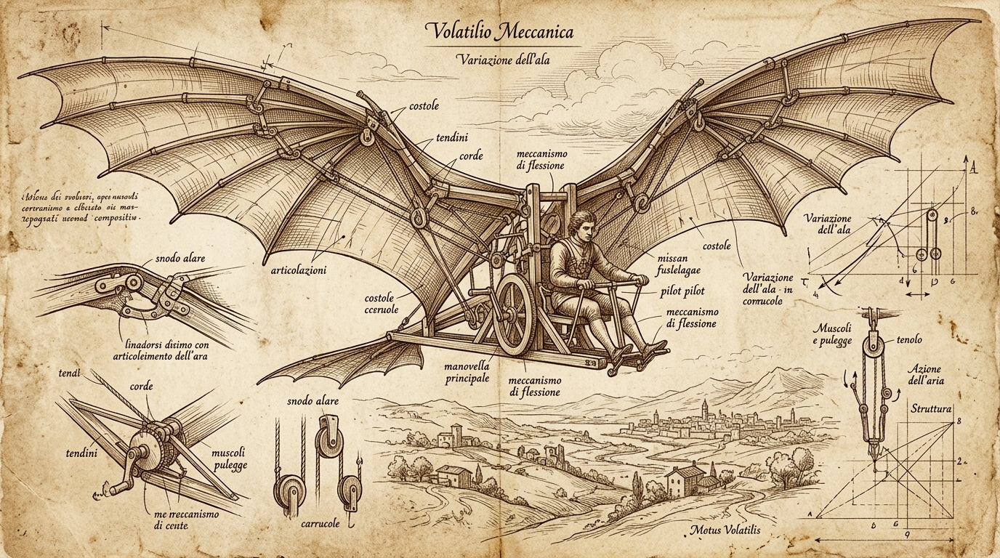
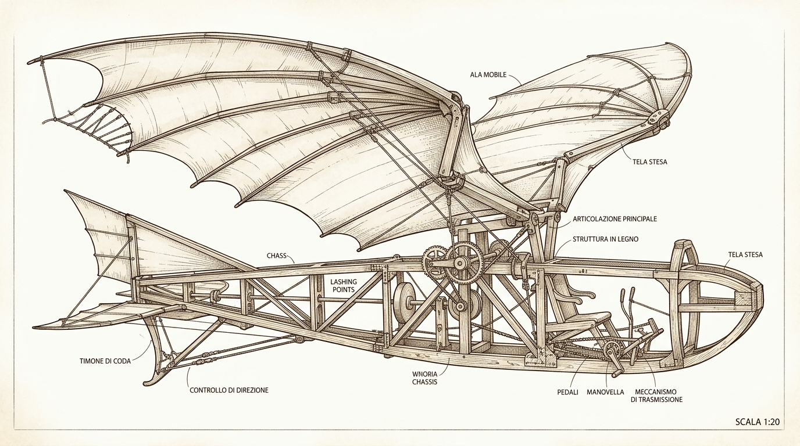
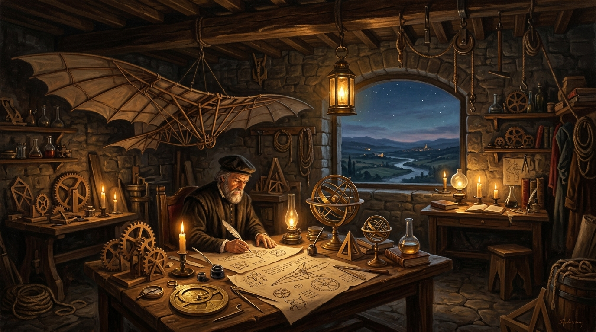
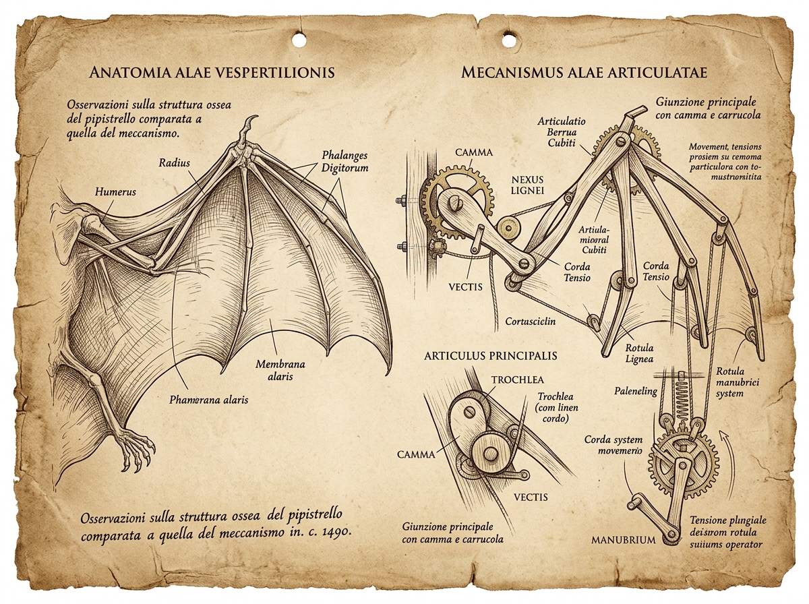
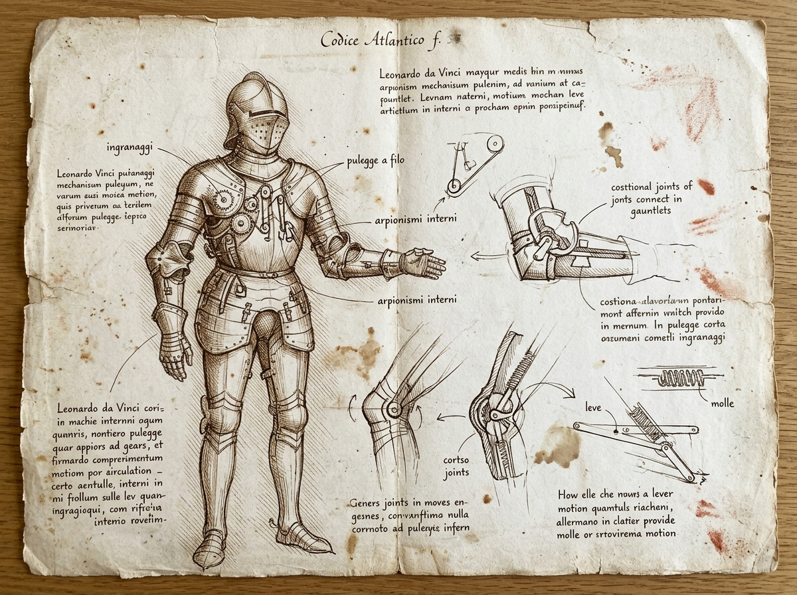
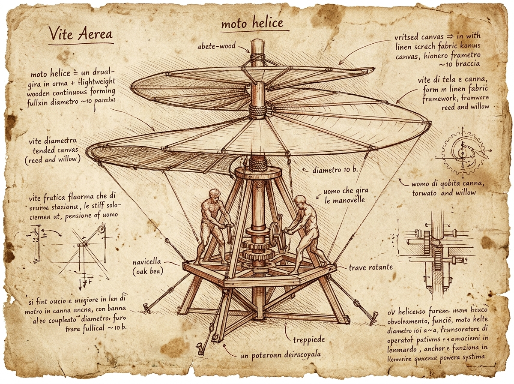

# Da Vinci's Dream (Il Sogno di Leonardo)
### An AI-Powered Renaissance Invention Laboratory

> **"Once you have tasted flight, you will forever walk the earth with your eyes turned skyward, for there you have been, and there you will always long to return."** — Attributed to Leonardo da Vinci



**Da Vinci's Dream** is an interactive computational laboratory where users explore historical Renaissance inventions, investigate how their mechanisms work, reconstruct them in interactive 3D, simulate their behavior with aerodynamic physics, and train reinforcement learning agents (PPO) to learn stable flapping flight.

---

## 🌟 Core Highlights & Features

- 📜 **Renaissance Editorial Aesthetics**: Designed with the authentic visual language of 15th-century Tuscan codices, aged parchment, iron-gall sepia cross-hatching, and workshop chiaroscuro.
- 🦅 **Functioning 2D Aerodynamic Physics Engine**: Simulates lift, drag, angle-of-attack stall limits, quasi-steady flapping-induced thrust and lift, pitch moments, wind fields, and ground collisions.
- 🧠 **Reinforcement Learning (Gymnasium + PPO)**: Custom continuous Gymnasium environment (`OrnithopterEnv-v0`) trained with PyTorch and Stable-Baselines3 PPO.
- 🎛️ **Baseline vs. Learned Benchmark**: Rigorous comparative evaluation of a proportional rule-based baseline controller versus the trained PPO policy across standardized seeds.
- 🎨 **Interactive 3D Ornithopter Visualizer**: WebGL 3D model featuring articulated wooden lattice fuselage, wing joint flapping synchronized to physics phase, camera controls (orbit, zoom, reset), side engineering view, and blueprint wireframe mode.
- 🏛️ **Invention Archive & Capability Registry**: Extensible registry system defining machine capabilities (`drawing_display`, `reconstruction_3d`, `mechanism_explanation`, `simulation`, `rl_training`).
- ✍️ **Sketch Explorer & Intake**: Upload historical sketches or technical drawings, annotate components, and receive honest capability status diagnostics.
- 🔒 **Zero Artificial Hallucinations**: Every telemetry plot, distance metric, success rate, and flight curve is derived from real numerical simulation. Core features work without requiring an external API key.

---

## 🏛️ Gallery of Generated Renaissance Assets

| Hero Codex Blueprint | Ornithopter Profile | Renaissance Workshop Lab |
| :---: | :---: | :---: |
|  |  |  |

| Bat Wing Linkage Study | Mechanical Knight Automaton | Aerial Screw (Helicopter) |
| :---: | :---: | :---: |
|  |  |  |

---

## 🛠️ Technology Stack

- **Backend**: Python 3.11/3.14, FastAPI, Uvicorn, Pydantic V2, Pytest
- **Physics & ML**: Gymnasium, PyTorch (CUDA-accelerated), Stable-Baselines3, NumPy, SciPy
- **Frontend**: React 18, Vite, TypeScript, Three.js, Lucide Icons, Canvas API, CSS Design Tokens
- **Asset Generation**: Antigravity Imagen model for authentic Renaissance codex illustrations

---

## 🚀 Quickstart & Installation

### Prerequisites
- Python 3.10+ (PyTorch, Gymnasium, Stable-Baselines3, FastAPI)
- Node.js v18+ and npm

### 1. Clone & Setup Workspace
```bash
git clone <repo-url>
cd "DaVinci's Dream"
```

### 2. Backend Setup & Startup
Install backend dependencies if needed:
```bash
pip install fastapi uvicorn pydantic gymnasium stable-baselines3 torch numpy scipy pytest
```

Start the FastAPI backend server:
```bash
python -m uvicorn backend.app.main:app --host 127.0.0.1 --port 8000 --reload
```
The API documentation is available at `http://127.0.0.1:8000/docs`.

### 3. Frontend Setup & Startup
In a separate terminal:
```bash
cd frontend
npm install
npm run dev
```
Open your browser at `http://localhost:5173`.

---

## 🧪 Training & Evaluating the RL Agent

### Train PPO Agent Headless:
```bash
python -m backend.app.agents.train_ppo --timesteps 50000 --save-path models/ornithopter_ppo.zip
```

### Run Scientific Evaluation Benchmark:
```bash
python -m backend.app.agents.evaluation --episodes 20 --policy-path models/ornithopter_ppo.zip
```

### Run Automated Backend Test Suite:
```bash
python -m pytest backend/tests -v
```

---

## 📁 Repository Structure

```
DaVinci's Dream/
├── README.md                          # Primary overview & instructions
├── IMPLEMENTATION_PLAN.md             # Active checklist & completion criteria
├── AGENTS.md                          # Coding guidelines & architecture boundaries
├── docs/                              # Deep engineering documentation
│   ├── PRD.md                         # Product requirements & user journeys
│   ├── ARCHITECTURE.md                # System topology & data flow
│   ├── DESIGN_SYSTEM.md               # Visual tokens, palette, and typography
│   ├── AI_AND_RL.md                   # Gymnasium env & PPO reward math
│   ├── PHYSICS_MODEL.md               # Aerodynamic equations & integration
│   ├── ASSET_MANIFEST.md              # Provenance & usage of image assets
│   ├── RESEARCH_AND_ATTRIBUTION.md    # Historical context vs. modern engineering
│   ├── API.md                         # FastAPI endpoint contracts
│   ├── TEST_PLAN.md                   # Quality assurance & verification plan
│   └── DEMO_SCRIPT.md                 # 60-90 second guided walkthrough
├── backend/
│   ├── app/
│   │   ├── main.py                    # FastAPI server entry point
│   │   ├── api/                       # API routes (simulation, training, artifacts)
│   │   ├── simulation/                # 2D aerodynamic flight engine & Gym env
│   │   ├── agents/                    # Baseline governor & SB3 PPO trainer
│   │   └── schemas/                   # Pydantic V2 data validation models
│   └── tests/                         # Pytest test suite
├── frontend/                          # React + Vite + Three.js application
├── models/                            # Trained neural network policy checkpoints
├── results/                           # Evaluation benchmark outputs & logs
└── public/
    └── assets/                        # High-resolution Renaissance codex artwork
```

---

## ⚖️ Known Limitations & Historical Distinctions
1. **Human Musculature**: Leonardo's original human-powered ornithopter could not achieve sustained level flight due to the physical limit of human muscle power ($\approx 3$ W/kg vs $\approx 100$ W/kg required for heavy flapping). In Da Vinci's Dream, the simulation launches from an elevated 25m cliff platform and utilizes continuous actuator power to explore what flapping parameters achieve stable gliding and powered flight.
2. **2D vs. 3D Aerodynamics**: The current physics engine models 2D planar longitudinal aerodynamics ($x, y, \theta$). Full 3D lateral-directional aerodynamics (yaw and roll aeroelastic flutter) will be introduced in future milestones.
